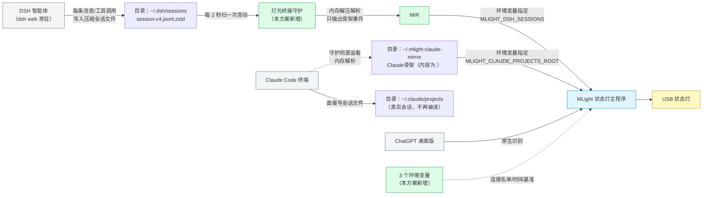
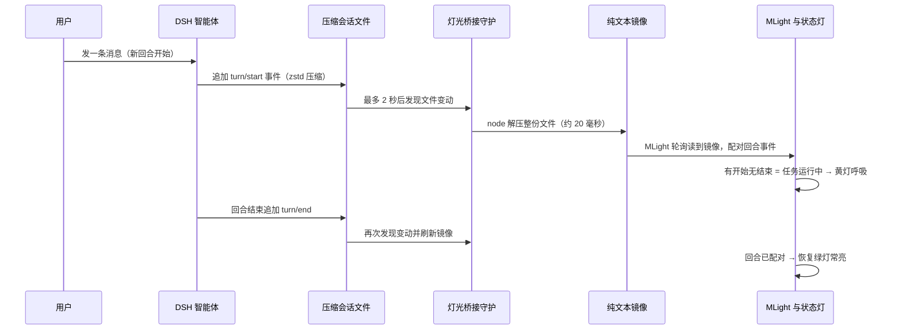
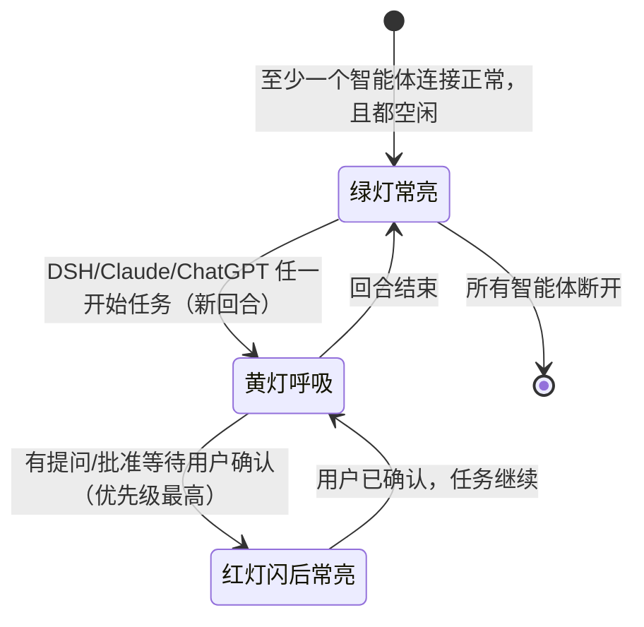

# 灯光桥接系统架构与性能

## 综述

> **产生背景**：6807AI状态灯MLight（下称 MLight）只能识别 ChatGPT 桌面版这类「应用程序形态」的智能体，识别不了命令行/Web 版 DeepSeek Harness（DSH）和终端版 Claude Code。2026-10-31 通过逆向 MLight 找到了症结，用「会话镜像 + 环境变量」补齐了识别链路。
> **文档目标**：用架构图和实测数据回答两个问题——这套东西复杂吗？占系统资源吗？顺便让没参与调试的人 5 分钟看懂全貌。
> **适用范围**：装了或准备装「灯光桥接安装包」的人；目标电脑上接手维护的 AI 助手（配合 `AGENTS.md` 使用）。

## 摘要

| 项目 | 值 |
|------|------|
| 创建时间 | 2026-10-31 20:06 |
| 更新时间 | 2026-10-31 21:00 |
| 当前版本 | v1 |

## 概述

- 灯光桥接 = 一个约 60 行的常驻脚本（藏在 `/Applications/灯光桥接.app` 里）+ 写进 MLight 启动配置的 3 个环境变量。
- 职责单一：把 DSH 的压缩会话文件「翻译」成 MLight 能直接读的纯文本，并告诉 MLight 去哪读、从什么时间读起。
- 不改动 MLight 本体、不碰 DSH、不联网、无第三方依赖（只用系统自带命令和一个已有的 node）。

## 核心内容

### 一、总架构图

我们添加的部分只有两个（图中绿色）；其余全是机器上原有的（灰色/蓝色）。

### 二、组件清单：本方案到底装了什么

| 组件                          | 位置                                  | 归属    | 说明                         |
| --------------------------- | ----------------------------------- | ----- | -------------------------- |
| 会话镜像守护                      | `/Applications/灯光桥接.app`            | 本方案新增 | 常驻脚本，每 2 秒把变动的压缩会话解压成纯文本镜像 |
| 镜像目录                        | `~/.mlight-dsh-mirror`              | 本方案新增 | 纯文本会话，MLight 直读，不再需要它自己去解压 |
| 3 个环境变量                     | MLight 的启动配置文件                      | 本方案新增 | 连接名单、会话目录指向、时间基准           |
| MLight 主程序                  | `/Applications/6807AI状态灯MLight.app` | 原厂已有  | 状态灯的全部判断逻辑都在它里面            |
| DSH / Claude Code / ChatGPT | 各自安装位置                              | 原厂已有  | 数据源头，本方案零改动                |

### 三、一条消息如何点亮黄灯（时序）

### 四、复杂吗：不复杂，量摆在这里

| 方面                 | 实情                           |
| ------------------ | ---------------------------- |
| 新增代码量              | 一个 bash 脚本约 60 行（一半是注释和日志保护） |
| 新增常驻进程             | 1 个（就是上面的脚本本身，不派生长驻子进程）      |
| 第三方依赖              | 0（只用系统命令 + 机器上已有的 node）      |
| 对 MLight 的改动       | 0 个文件（只往它的启动配置里合并 3 个环境变量）   |
| 对 DSH / Claude 的改动 | 0                            |
| 网络行为               | 0（全在本机磁盘上倒腾）                 |

复杂度的真相：识别逻辑的复杂性全在 MLight 原厂程序里（它的判定要过六道闸门，见 `调试笔记.md`）；本方案不去碰那些复杂度，只是把数据提前铺成它最省事的样子。

### 五、占用性能吗：实测数据（2026-10-31，hymac 的机器）

| 指标           | 实测值            | 直观解读                                |
| ------------ | -------------- | ----------------------------------- |
| 守护进程平均 CPU   | 约 0.17% 单核     | 空转时几乎为零，只在会话文件变动的一瞬干活               |
| 守护进程内存       | 2.9 MB         | 不到一张照片的大小                           |
| 单次解压耗时       | 20 毫秒          | 只在会话文件变化时触发；DSH 干活越频繁触发越多，但每次都是一闪而过 |
| 磁盘写入量（活跃时）   | 每轮只写骨架事件，整目录实测共 4 KB | 内容在内存解析，落盘的只有回合/提问标记；对 DSH 原文件永远只读 |
| 磁盘写入量（空闲时）   | 0              | 没有会话变动就一个字节都不写                       |
| 镜像磁盘占用（隐私版）   | 4 KB           | 骨架事件极小；对照：曾经的全量镜像 17 MB 已彻底清除 |
| 镜像磁盘占用       | 17 MB（3 个活跃会话） | 只保留活跃会话；对照：原始压缩会话目录 56 MB           |
| MLight 主程序内存 | 185 MB         | 对照项——这是原厂程序自身的占用，与本方案无关             |

**口径定义**：

| 字段 | 定义 | 计算公式 / 来源 |
|------|------|-----------------|
| 守护进程平均 CPU | 守护脚本运行期间平均占用的单个 CPU 核心比例 | 累计 CPU 时间 1.85 秒 ÷ 运行时长 17 分 45 秒（`ps` 实测） |
| 守护进程内存 | 常驻脚本的物理内存占用 | `ps` 的 RSS 值 2960 KB |
| 单次解压耗时 | node 把一份压缩会话文件完整解压一次的耗时 | `/usr/bin/time` 三次测量，均为 0.02 秒 |
| 磁盘写入量（活跃时） | DSH 会话持续写入期间，守护写入镜像目录的数据量 | 隐私版上线后镜像目录体积实测（4 KB，含 8 个回合的骨架） |
| 磁盘写入量（空闲时） | 无任何 DSH 会话变动时，守护写入镜像目录的数据量 | 守护每 2 秒仅比对文件修改时间（元数据读取），无内容读写 |
| 镜像磁盘占用 | 镜像目录当前体积 / 文件数 | `du` 与 `find` 实测（已清理历史文件后的稳态值） |
| MLight 主程序内存 | 原厂 MLight 进程的物理内存 | `ps` 的 RSS 值 189104 KB |

### 六、灯光状态机（谁的灯、什么规则）

## 注意事项

- DSH 的黄灯从「下一条新消息（新回合）」开始亮——MLight 原厂是增量设计，只统计它开始监视之后新开的回合，不回溯正在跑的老回合。
- 升级或重装 MLight 会把它启动配置里的 3 个环境变量冲掉（症状：DSH/Claude 变回「未运行」），重跑安装包里的 `安装.command` 即可恢复。
- nvm 更换 node 版本后，守护脚本里的 node 路径要跟着换，同样重跑 `安装.command`。
- 隐私边界：状态灯（闭源软件）全程只能读到骨架事件——回合起止与提问应答的标记（编号/时间戳），任何用户文本、路径、命令、输出都不会出现在镜像里。
- 镜像目录只应保留活跃会话；如果发现它涨得很大，说明混入了历史文件，可参照安装器里「首跑基准=当前时刻」的逻辑清理。

---

## 变更历史

| 版本 | 日期 | 变更内容 |
|------|------|---------|
| v1 | 2026-10-31 | 初始版本：架构图、时序图、状态机、复杂度与性能实测 |
| v2 | 2026-10-31 | 镜像写入升级为增量追加；性能表新增磁盘写入量指标（活跃/空闲） |
| v3 | 2026-10-31 | 隐私改造：镜像改为无内容骨架事件（内存解析、只落盘标记），彻底移除全量内容镜像 |
| v4 | 2026-10-31 | Claude 纳入骨架镜像；禁用 nettop 流量统计采样（假数据文件），DSH 灯响应降至 2 秒 |
